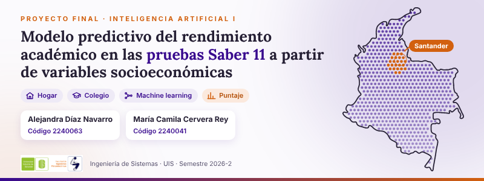

# Modelo predictivo del rendimiento académico en las pruebas Saber 11 a partir de variables socioeconómicas

**Autores:** Alejandra Díaz Navarro, María Camila Cervera Rey

**Objetivo:** Desarrollar y comparar modelos de machine learning que predigan el puntaje global de las pruebas Saber 11 2025 a partir de variables socioeconómicas y escolares, y evaluar qué tan bien generalizan para Santander y para distintos tipos de colegio.

**Dataset:** Resultados de las pruebas Saber 11 publicados por el ICFES, periodos 2025-1 y 2025-2 (569,174 estudiantes inscritos como estudiantes de colegio). Se usan el puntaje global y las variables del hogar, del colegio y del estudiante.
Descarga: [Resultados ICFES 2019-2025 (Kaggle)](https://www.kaggle.com/datasets/esgaritus/resultados-icfes-2019-2025)

**Modelos:** Regresión lineal, árbol de decisión, Random Forest, SVM, HistGradientBoosting, red neuronal (MLP), información mutua (SelectKBest), Optuna, PCA, t-SNE, K-means, Agglomerative Clustering, DBSCAN, importancia por permutación.

**Enlaces:**
- Código: [enlace al notebook](https://drive.google.com/file/d/1nj7vt6mNO3gOsDwwzavLwaLrhoLgZX2b/view?usp=sharing)
- Video: [enlace al video](https://youtu.be/aVcWpGFUv9c)
- Repositorio: [enlace al repositorio](https://github.com/Mcamilacr/Proyecto-IA-I)
- Diapositivas: [enlace a la presentación](https://canva.link/h5h33q56wajpyhc)
